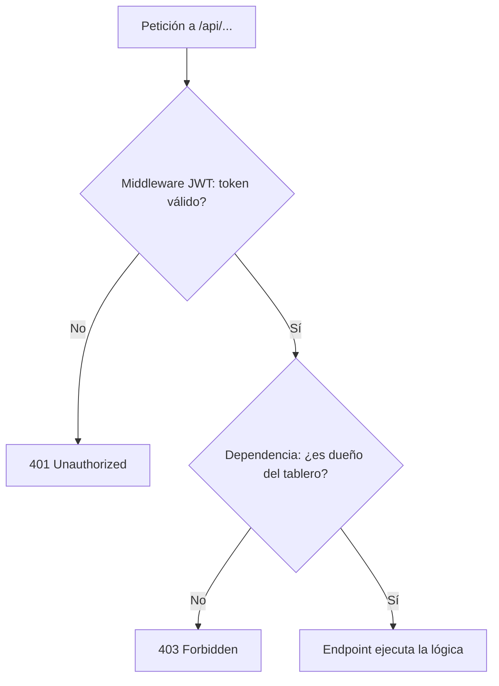

# Guía de cambios del Sprint 1: tests, seguridad y cobertura

Esta guía explica **qué** cambiamos, **por qué** y **para qué**, y cómo usarlo tú mismo. Está pensada para aprender, así que cada sección termina con algo que puedes ejecutar.

## Índice

1. [Visión general](#1-visión-general)
2. [Conceptos clave](#2-conceptos-clave)
3. [Backend: tests con pytest](#3-backend-tests-con-pytest)
4. [Backend: seguridad (autenticación y autorización)](#4-backend-seguridad)
5. [Backend: funcionalidades nuevas y bugs corregidos](#5-backend-funcionalidades-nuevas-y-bugs-corregidos)
6. [Backend: migraciones de base de datos](#6-backend-migraciones)
7. [Frontend: Vitest y Testing Library](#7-frontend-vitest-y-testing-library)
8. [Frontend: cobertura](#8-frontend-cobertura)
9. [Comandos de uso diario](#9-comandos-de-uso-diario)
10. [Pendientes y deuda técnica](#10-pendientes-y-deuda-técnica)
11. [Ejercicios para dominarlo](#11-ejercicios-para-dominarlo)

---

## 1. Visión general

El objetivo del sprint fue tener una **red de seguridad automática**: tests que te avisen si rompes algo. Al escribirlos descubrimos que la API **no protegía los datos entre usuarios**, y eso se arregló también.

| Área | Qué se hizo | Resultado |
|---|---|---|
| Backend | Tests de auth, tableros, listas, tarjetas y tags | 31 tests |
| Backend | Autenticación (middleware) y autorización (dueño del recurso) | Un usuario ya no ve ni toca datos ajenos |
| Backend | Mover tarjetas con `position`, tags por usuario, bugs corregidos | API consistente |
| Frontend | Vitest + Testing Library + cobertura | 39 tests, ~41% de cobertura |

Flujo mental que seguimos: **escribir un test → el test falla porque falta algo → arreglar el código → el test pasa**. Es la base de TDD (desarrollo guiado por tests).

---

## 2. Conceptos clave

### Autenticación vs. autorización

| | Pregunta | Fallo | Código HTTP |
|---|---|---|---|
| **Autenticación** | ¿Quién eres? (¿tienes un token válido?) | Sin token o token inválido | `401 Unauthorized` |
| **Autorización** | ¿Puedes hacer **esto**? (¿es tu recurso?) | Token válido, pero recurso ajeno | `403 Forbidden` |

Ejemplo: iniciar sesión te autentica. Intentar borrar el tablero de otra persona es un problema de autorización.

### Pirámide de tests

- **Unitarios**: una función o hook aislado (`useTimer`).
- **De componente**: un componente renderizado (`Login`).
- **De integración / API**: una petición HTTP completa contra la app (los tests de backend).

### Fixtures (pytest)

Una *fixture* es una función que prepara datos o recursos para un test. El test la pide **por nombre como argumento** y pytest se la entrega.

```python
def test_algo(client, auth_headers):   # pytest inyecta ambas
    ...
```

### Mocks (Vitest)

Un *mock* reemplaza una dependencia real por una falsa que tú controlas. Así `Login` se prueba sin un servidor real: simulamos `login()` y comprobamos que se llamó bien.

---

## 3. Backend: tests con pytest

Archivos en `backend/tests/`:

| Archivo | Qué verifica |
|---|---|
| `conftest.py` | Infraestructura compartida (BD en memoria, cliente, usuarios) |
| `test_auth.py` | Registro y login |
| `test_boards.py` | Crear tableros, aislamiento entre usuarios |
| `test_lists.py` | Crear listas, `403` en tablero ajeno, `ListUpdateCards` |
| `test_cards.py` | Mover, borrar, búsqueda y filtros por dueño |
| `test_tags.py` | Middleware, tags por usuario |

### 3.1 `conftest.py`: la base de todo

- **Base de datos en memoria**: `sqlite:///:memory:` con `StaticPool`. Cada test arranca limpio (`setup_database` crea y borra las tablas), sin tocar tu `trello.db`.
- **`client`**: un `TestClient` de FastAPI que reemplaza `get_db` por la sesión de pruebas (`dependency_overrides`).
- **`auth_headers` y `other_auth_headers`** (las agregamos nosotros): registran un usuario, hacen login y devuelven `{"Authorization": "Bearer <token>"}`. Representan al **usuario A** y al **usuario B**, necesarios para probar que A no accede a lo de B.

```python
def _make_user(client, fake):
    # 1. registra con datos aleatorios (Faker)
    # 2. hace login
    # 3. devuelve el header Authorization
```

### 3.2 Anatomía de un test

El patrón es siempre **Arrange → Act → Assert**:

```python
def test_create_list_in_other_users_board_returns_403(client, auth_headers, other_auth_headers):
    # Arrange: el usuario A crea un tablero
    board_id = _create_board(client, auth_headers)

    # Act: el usuario B intenta crear una lista en él
    response = client.post(
        f"/api/boards/{board_id}/lists/",
        json={"title": "Intruso", "board_id": board_id},
        headers=other_auth_headers,
    )

    # Assert
    assert response.status_code == 403
```

### 3.3 Los tests pedidos

| Pedido | Test |
|---|---|
| Crear tablero autenticado | `test_authenticated_user_can_create_board` |
| No ver tableros ajenos | `test_user_cannot_see_other_users_boards` |
| Crear lista en un tablero | `test_create_list_in_board` |
| Lista en tablero ajeno → 403 | `test_create_list_in_other_users_board_returns_403` |
| Mover tarjeta A→B actualiza `list_id` y `position` | `test_move_card_updates_list_id_and_position` |
| Borrar tarjeta sin romper la lista | `test_delete_card_does_not_break_list` |
| Mover tarjeta ajena → 403 | `test_move_other_users_card_returns_403` |

### 3.4 Cómo se ejecuta

```bash
cd backend
venv/bin/python -m pytest -q                   # todo
venv/bin/python -m pytest tests/test_cards.py  # un archivo
venv/bin/python -m pytest -k "move"            # tests cuyo nombre contenga "move"
venv/bin/python -m pytest -x                   # parar en el primer fallo
venv/bin/python -m pytest -W ignore            # sin avisos de deprecación
```

> [!TIP]
> Usa `venv/bin/python -m pytest` y no `pytest` a secas: asegura que se usa el Python con tus dependencias.

---

## 4. Backend: seguridad

### 4.1 El problema que encontramos

Al escribir "crear lista en tablero ajeno devuelve 403", el test **no podía pasar**: los endpoints de listas y tarjetas no pedían token ni comprobaban el dueño. Cualquiera podía leer, modificar o borrar datos de otros usuarios. Un test bien pensado destapó una vulnerabilidad real.

### 4.2 Las dos capas de defensa



**Capa 1: autenticación en el middleware.** Archivo `backend/app/core/middleware.py`, registrado en `main.py`.

- Se ejecuta **antes** de cualquier endpoint, para todo `/api/*`.
- Valida firma y expiración del JWT. Si falla, devuelve `401`.
- **No** exige token en `/api/auth/login`, `/api/auth/register`, peticiones `OPTIONS` (el preflight de CORS) ni rutas fuera de `/api/` como `/docs`.
- Se registra **antes** que CORS para que CORS quede como capa externa y los `401` también lleven cabeceras CORS. En Starlette, el último middleware añadido es el más externo.

**Capa 2: autorización en dependencias.** Archivo `backend/app/core/dependencies.py`.

- `require_board_owner`: el tablero existe (`404`) y es tuyo (`403`).
- `require_list_in_board`: lo anterior, y además que la lista pertenezca a ese tablero (`404` si no).

> [!IMPORTANT]
> ¿Por qué no hacer todo en el middleware? La autorización depende **del recurso concreto**: hay que consultar la base de datos para saber quién es el dueño del tablero `7`. El middleware solo ve la petición; las dependencias de FastAPI ya tienen acceso a la BD y a los parámetros de la ruta.

### 4.3 Cómo se aplica en los routers

En vez de repetir la comprobación en cada endpoint, se declara **a nivel de router**:

```python
# lists.py
router = APIRouter(dependencies=[Depends(require_board_owner)])

# cards.py
router = APIRouter(dependencies=[Depends(require_list_in_board)])
```

Así **todos** los endpoints del router quedan protegidos, incluidos los que se añadan en el futuro. Esto reduce el riesgo de olvidar una comprobación.

Las rutas anidan los ids en el prefijo (ver `main.py`):

```
/api/boards/{board_id}/lists/{list_id}/cards/{card_id}
```

Por eso `board_id` y `list_id` llegan como parámetros de ruta a las dependencias.

### 4.4 Defensa contra ids "inyectados"

Había un atajo de ataque: en la URL pones **tu** tablero, y en el body un `list_id` **ajeno**. Cerramos esos huecos:

| Endpoint | Verificación añadida |
|---|---|
| `POST .../lists/` | `list_data.board_id == board_id` de la URL, si no `400` |
| `POST .../cards/create` | `card_data.list_id == list_id` de la URL, si no `400` |
| `GET/PUT/DELETE .../cards/{card_id}` | `_ensure_card_in_list`: la tarjeta debe estar en esa lista, si no `404` |
| `PUT .../lists/{id}/cards` | Cada tarjeta debe ser del usuario (`403`), se valida **todo antes de mover** |

> [!NOTE]
> En `ListUpdateCards` se valida **todo primero** y se mueve **después**. Así, si la tercera tarjeta es ajena, no quedan las dos primeras movidas a medias (operación todo o nada).

### 4.5 Filtrado por dueño en consultas

`/search` y `/filter_by_tag` cruzan tableros: antes devolvían tarjetas de **todos** los usuarios. En `card_repository.py` el helper `_owned_by` encadena `Card → List → Board` y filtra por `Board.user_id`:

```python
def _owned_by(self, query, user_id):
    if user_id is None:
        return query
    return (query.join(List, Card.list_id == List.id)
                 .join(Board, List.board_id == Board.id)
                 .filter(Board.user_id == user_id))
```

El `user_id` sale del token en el endpoint y viaja por servicio → repositorio.

### 4.6 Tags por usuario

Antes un tag era global (`name` único para todos) y cualquiera veía los de otros. Ahora:

- `Tag.user_id` indica el dueño.
- La unicidad es por **(usuario, nombre)**: dos usuarios pueden tener un tag "urgente".
- Ver, editar o borrar el tag de otro devuelve `404` (no `403`), para **no revelar que existe**.
- Crear un tag repetido propio devuelve `409 Conflict`.
- Asociar un tag a una tarjeta exige que **tanto el tag como la tarjeta** sean tuyos.

### 4.7 Cómo probar la seguridad a mano

```bash
cd backend && venv/bin/uvicorn app.main:app --reload --port 8003
# en otra terminal:
curl -i http://localhost:8003/api/boards/                    # 401: sin token
curl -i -X POST http://localhost:8003/api/auth/login \
  -d "username=tu@email.com&password=tu_clave"               # devuelve access_token
curl -i http://localhost:8003/api/boards/ \
  -H "Authorization: Bearer <access_token>"                  # 200
```

---

## 5. Backend: funcionalidades nuevas y bugs corregidos

### 5.1 Nuevas

| Cambio | Para qué |
|---|---|
| `Card.position` | Guardar el **orden** de las tarjetas dentro de una lista |
| `PUT /cards/{id}/move` con `{list_id, position}` | Mover una tarjeta a otra lista y fijar su posición (por defecto va al final) |
| `CardResponse` con `list_id` y `position` | Que el frontend sepa dónde está cada tarjeta |
| `POST /cards/create` acepta `tags` | Antes ignoraba el campo `tags` del body |
| `ListUpdateCards` asigna `position` | Respetar el orden recibido al reordenar |

Ejemplo de uso del endpoint de mover:

```http
PUT /api/boards/1/lists/10/cards/55/move
Authorization: Bearer <token>
Content-Type: application/json

{"list_id": 11, "position": 0}
```

Permisos: debes ser dueño del tablero de **origen y destino** (`403` si no).

### 5.2 Bugs reales que corregimos

| Bug | Efecto | Arreglo |
|---|---|---|
| `card = Card(...)` sobrante en `create_card` | Pisaba la tarjeta construida: **no se podían crear tarjetas** | Se eliminó la línea |
| `.option(` en `search_cards` | `AttributeError` siempre: la búsqueda **no funcionaba** | Se quitó (era `.options`, y el eager load sobraba) |
| `tag.cards.append(card_id)` | Añadía un **entero** a una relación de objetos | Se busca el objeto `Card` |
| `CardResponse.tags: list[str]` recibía objetos `Tag` | Error de serialización con tarjetas etiquetadas | `field_validator` que convierte a nombres |
| `Tag(name=name)` sin `color` | Fallaba (`color` es obligatorio) | Color por defecto `#808080` |
| `from faker import fake` en `test_auth.py` | `pytest` completo fallaba al importar | Se eliminó el import |

> [!TIP]
> Fíjate en cuántos de estos bugs estaban escondidos porque **ningún test ejercitaba ese código**. Es la mejor razón para tener tests.

---

## 6. Backend: migraciones

Cambiamos el modelo (`Card.position`, `Tag.user_id`). `Base.metadata.create_all()` **crea tablas nuevas pero no modifica las existentes**, así que una BD vieja no tendría las columnas.

No hay Alembic en el proyecto, así que `main.py` incluye una migración ligera en el evento `startup`:

1. **`cards.position`**: si falta, `ALTER TABLE cards ADD COLUMN position INTEGER NOT NULL DEFAULT 0`.
2. **`tags.user_id`**: SQLite no permite quitar un `UNIQUE` de una columna, así que se **reconstruye la tabla**: renombrar la vieja, crear la nueva con el modelo actual, copiar los datos y borrar la vieja.

Los tags que ya existían quedan con `user_id` vacío y ningún usuario los ve.

> [!WARNING]
> Esto es una solución provisional. Si el proyecto crece, adopta **Alembic**: versiona los cambios de esquema, permite revertirlos y es el estándar con SQLAlchemy. Dijiste que la base de datos se borrará más adelante; entonces puedes eliminar este código y partir de cero.

---

## 7. Frontend: Vitest y Testing Library

### 7.1 Qué es cada herramienta

| Herramienta | Función |
|---|---|
| **Vitest** | El ejecutor de tests (equivalente a pytest). Se integra con Vite |
| **jsdom** | Simula un navegador dentro de Node |
| **@testing-library/react** | Renderiza componentes y los consulta como lo haría un usuario |
| **@testing-library/user-event** | Simula interacción realista: escribir, hacer clic, hover |
| **@testing-library/jest-dom** | Matchers como `toBeInTheDocument()` y `toBeVisible()` |
| **@vitest/coverage-v8** | Mide qué porcentaje del código ejecutan los tests |

### 7.2 Configuración

**`vite.config.js`** (bloque `test`):

```js
test: {
  environment: 'jsdom',            // simula el navegador
  globals: true,                   // describe/it/expect/vi sin importarlos
  setupFiles: './src/test/setup.js',
  coverage: { provider: 'v8', include: ['src/**/*.{js,jsx}'], thresholds: { statements: 40, lines: 40 }, ... },
  css: { modules: { classNameStrategy: 'non-scoped' } },
}
```

**`src/test/setup.js`**: importa `@testing-library/jest-dom`, que añade los matchers.

**`package.json`**: `"test": "vitest"` y `"coverage": "vitest run --coverage"`.

### 7.3 Filosofía de Testing Library

> "Cuanto más se parezcan tus tests a cómo usa el software tu usuario, más confianza te darán."

Por eso buscamos elementos por **rol y texto visible**, no por clases CSS:

```jsx
screen.getByRole('button', { name: /iniciar sesión/i })   // bien
screen.getByLabelText(/contraseña/i)                      // bien
// evitar: document.querySelector('.btn-primary')
```

Prioridad recomendada: `getByRole` → `getByLabelText` → `getByText` → `getByTestId` (último recurso).

Variantes de consulta:

| Prefijo | Si no existe | Cuándo usarlo |
|---|---|---|
| `getBy` | Lanza error | Debe estar presente |
| `queryBy` | Devuelve `null` | Comprobar que **no** está |
| `findBy` | Espera y lanza error | Aparece de forma asíncrona |

### 7.4 Los tests, uno por uno

#### `Card.test.jsx`

- Renderiza el título.
- El botón de borrar **aparece al hacer hover** y desaparece al salir.
- Borrar pide confirmación y luego llama a `onDelete(columnaId, id)`.

Para que el hover funcionara **añadimos una función a `Card.jsx`**: un botón "Borrar tarjeta" controlado por el estado `isHovered`. Antes, borrar solo estaba dentro del modal. El botón abre el modal con la confirmación ya visible, para no borrar por accidente.

La tarjeta usa `useDraggable` de dnd-kit, por eso en el test se envuelve en `<DndContext>`.

> [!NOTE]
> En el test de borrado usamos `fireEvent.click` en lugar de `user.click`. En jsdom, `user.click` mueve el puntero y dispara un `mouseleave` que oculta el botón antes del clic. Es una limitación del entorno de pruebas, no un bug de la app.

#### `ProtectedRoute.test.jsx`

Se simula `useAuth` con tres estados y se comprueba el resultado dentro de un `MemoryRouter`:

| `isAuthenticated` | `isLoading` | Resultado |
|---|---|---|
| `false` | `false` | Redirige a `/login` |
| `true` | `false` | Muestra el contenido |
| `false` | `true` | Muestra "Cargando..." (sin redirigir) |

#### `Login.test.jsx`

Se simula `useAuth` y `useNavigate`. Se escribe en el formulario y se comprueba que se llama a `login('ana@example.com', 'secreto123')` y se navega a `/`. Otro test cubre el fallo: se muestra el error y **no** se navega.

> [!NOTE]
> No existe un "servicio de login" aparte. El login vive en `AuthContext` y se usa con `useAuth()`. Por eso se mockea el hook.

#### Tests añadidos para subir la cobertura

| Archivo | Cubre |
|---|---|
| `AuthContext.test.jsx` | login, registro, logout, token inválido, `useAuth` fuera del provider |
| `services.test.js` | Llamadas HTTP y el interceptor que añade el token Bearer |
| `Register.test.jsx` | Validaciones (contraseñas distintas, menos de 6 caracteres) y error del servidor |
| `useTimer.test.js` | Temporizador con relojes falsos |
| `useCard.test.js`, `useTableros.test.js` | Hooks con `renderHook` |
| `Temporizador.test.jsx` | Formato `MM:SS` y modo trabajo o descanso |

### 7.5 Técnicas que conviene dominar

**Mockear un módulo** (se hace antes de los imports de lo que lo usa):

```js
vi.mock('../context/AuthContext', () => ({ useAuth: vi.fn() }))
useAuth.mockReturnValue({ login: vi.fn().mockResolvedValue({}) })
```

**Probar un hook**:

```js
const { result } = renderHook(() => useTimer())
act(() => result.current.iniciar())     // act: envuelve cambios de estado
```

**Relojes falsos** para no esperar de verdad:

```js
vi.useFakeTimers()
act(() => vi.advanceTimersByTime(1000))   // avanza 1 s al instante
```

**Mockear `axios`** devolviendo una instancia falsa por cada `axios.create()`, y capturar el interceptor para probarlo.

### 7.6 Bug encontrado por los tests

`CardService.js` **no enviaba el token**. Tras proteger el backend, marcar una tarjeta como completada habría fallado con `401`. Se añadió el mismo interceptor de `BoardService` y `TableroService`, y `services.test.js` lo verifica para los tres.

---

## 8. Frontend: cobertura

### 8.1 Qué mide

La cobertura es el porcentaje de código que se **ejecuta** durante los tests. Métricas:

| Métrica | Significado |
|---|---|
| Statements (sentencias) | Instrucciones ejecutadas |
| Branches (ramas) | Caminos de `if`/`else`/`?:` recorridos |
| Functions | Funciones llamadas |
| Lines | Líneas ejecutadas |

### 8.2 Una trampa importante

Por defecto Vitest solo cuenta los archivos que **los tests importan**. Con eso el resultado era 58%, pero era engañoso: los archivos sin tests no aparecían. Al medir todo `src/` la cobertura real era **11%**.

La configuración `coverage.include: ['src/**/*.{js,jsx}']` obliga a contar **todo**. Ahora el número es honesto.

| Medición | Sentencias |
|---|---|
| Antes (solo archivos importados) | 57.85% (engañoso) |
| Todo `src/` sin tests nuevos | 11.04% |
| Todo `src/` con los tests nuevos | **40.9%** |

### 8.3 Umbral automático

`thresholds: { statements: 40, lines: 40 }` hace que `npm run coverage` **falle** si baja del 40%. Así la meta se cumple sola y se detecta una regresión en CI.

### 8.4 Cómo leer el reporte

```
File          | % Stmts | % Branch | % Funcs | % Lines | Uncovered Line #s
Login.jsx     |     100 |    83.33 |     100 |     100 | 24
Card.jsx      |   47.36 |    43.24 |   43.75 |   51.42 | ...-79,89,168-219
```

La última columna indica **qué líneas faltan por probar**: ahí es donde escribir el siguiente test.

> [!IMPORTANT]
> Un 100% de cobertura **no** garantiza que no haya bugs: solo dice que el código se ejecutó, no que se verificara bien. Usa la cobertura para **encontrar zonas sin probar**, no como un fin en sí misma.

---

## 9. Comandos de uso diario

### Backend

```bash
cd backend
venv/bin/python -m pytest -q                       # suite completa
venv/bin/python -m pytest tests/test_cards.py -v   # un archivo, detallado
venv/bin/uvicorn app.main:app --reload --port 8003 # servidor local
```

### Frontend

```bash
cd frontend
npm test                    # modo watch: re-ejecuta al guardar
CI=true npm test            # una sola vez (como en CI)
npx vitest run src/__tests__/Card.test.jsx   # un archivo
npm run coverage            # cobertura con umbral del 40%
npm run dev                 # servidor de desarrollo
```

> [!TIP]
> `npm test` se queda en **modo watch**. Para que termine siempre, cambia el script a `"test": "vitest run"` y deja `vitest` para uso interactivo.

### Git

```bash
git status
git add -- <archivos>        # añade solo lo que quieres
git commit                   # formato Conventional Commits
git push -u origin improve/testing-foundation
```

Formato de commit: `tipo(ámbito opcional): descripción`. Tipos: `feat`, `fix`, `test`, `docs`, `refactor`, `chore`, `style`.

---

## 10. Pendientes y deuda técnica

| Tema | Detalle |
|---|---|
| Push y PR | El commit `29ed3a5` está hecho; falta el `git push` (pide la passphrase de SSH) y abrir el PR a `main` |
| `trello.db` versionado | Se modifica al ejecutar la app; conviene sacarlo de git y añadirlo a `.gitignore` |
| `FilterBar.jsx` | Roto: usa `handleSearch` y `handleFilterChange`, que no existen, y llama a `api/v1/tags` |
| `TemporizadorBotones` | Importa `prop-types`, que no está en `package.json` |
| Cobertura de ramas y funciones | 29% y 33%, por debajo del 40% |
| Sin tests | `useTablero` (197 líneas), `Tablero`, `Columna`, `Cabecera`, `Menu` |
| `npm audit` | Reportó 17 vulnerabilidades tras instalar; no se revisaron |
| Migraciones | Ligeras y manuales; migrar a Alembic si el proyecto crece |
| Cobertura del backend | No hay `pytest-cov`; no se mide |
| Frontend y `401` | Si un token expira, el frontend aún no redirige a `/login` de forma global |

---

## 11. Ejercicios para dominarlo

Ordenados de menor a mayor dificultad. Haz cada uno **primero escribiendo el test** y viéndolo fallar.

1. **Observar un fallo.** En `middleware.py`, quita la comprobación del token y ejecuta `pytest`. Mira qué tests fallan y por qué. Después restáuralo.
2. **Test nuevo, backend.** Escribe un test de que `DELETE /api/boards/{id}` de otro usuario devuelve `403`. Usa `test_boards.py` como plantilla.
3. **Test nuevo, backend.** Comprueba que crear una tarjeta con `list_id` distinto al de la URL devuelve `400`.
4. **Test nuevo, frontend.** En `Card.test.jsx`, añade un test de que el checkbox llama a `updateCardCheckStatus`. Pista: `userEvent` + `screen.getByRole('checkbox')`.
5. **Subir cobertura.** Corre `npm run coverage`, elige un archivo con 0% y escribe tests hasta llegar al 80% en él.
6. **Interceptor 401.** Haz que, cuando una petición devuelva `401`, el frontend borre el token y redirija a `/login`. Escribe primero el test del interceptor.
7. **Migrar a Alembic.** Sustituye las migraciones de `startup` por Alembic con una revisión inicial.
8. **Automatizar.** Crea un workflow de GitHub Actions que ejecute `pytest` y `npm run coverage` en cada PR. Así el último criterio del sprint ("PR con los tests en verde") se comprueba solo.

---

## Mapa de archivos modificados

**Backend**

| Archivo | Cambio |
|---|---|
| `app/core/middleware.py` (nuevo) | Middleware JWT |
| `app/core/dependencies.py` | `require_board_owner`, `require_list_in_board` |
| `app/main.py` | Registro del middleware y migraciones de arranque |
| `app/api/v1/lists.py` | Protección por dueño, validación de tarjetas |
| `app/api/v1/cards.py` | Protección, endpoint `move`, scoping de búsqueda |
| `app/api/v1/tag.py` | Tags por usuario y comprobación de dueño |
| `app/domain/entities/card.py` | Columna `position` |
| `app/domain/entities/tag.py` | `user_id` y unicidad por usuario |
| `app/domain/schemas/card.py` | `CardMove`, `list_id`, `position`, validador de tags |
| `app/infrastructure/repositories/*` | `_owned_by`, `move_card`, correcciones de bugs |
| `app/services/*` | Parámetros de usuario y posición |
| `tests/*` (nuevo) | 31 tests |

**Frontend**

| Archivo | Cambio |
|---|---|
| `vite.config.js` | Configuración de Vitest y cobertura |
| `package.json` | Dependencias y scripts `test` y `coverage` |
| `src/test/setup.js` (nuevo) | Carga de jest-dom |
| `src/__tests__/*` (nuevo) | 39 tests |
| `src/components/Card/Card.jsx` y `.module.css` | Botón de borrar en hover |
| `src/services/CardService.js` | Interceptor con token |
